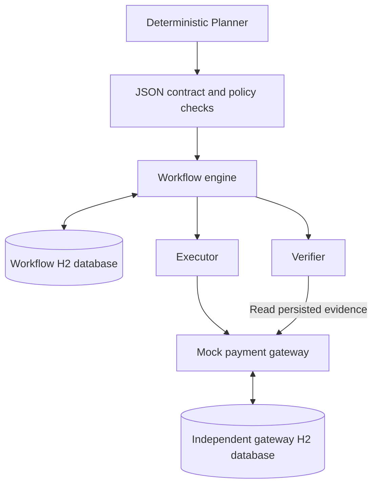

# When AI Agents Retry

An offline Java demonstration for Krishna Kandi’s DevFest Troy 2026 session, **When AI Agents Retry: Building Reliable Event-Driven Workflows**.

A deterministic Planner proposes a synthetic payment instruction. Application policy authorizes it. The Executor submits it to a durable mock gateway. The Verifier reads the gateway’s records and compares them with the approved intent.

The central failure is a real JVM halt **after the gateway commits and before the workflow saves the receipt or acknowledges the event**. A new JVM recovers the same action without submitting another instruction.

This is application architecture. The demonstration needs no model service, cloud account, internet connection, container, broker, or credentials. Gateway acceptance is the demonstrated outcome. All account and beneficiary references are synthetic. The JSON is a custom application contract.

## Run the prepared demonstration

Use the supplied `agent-retry-demo.jar` in the complete session kit. Java 17 is the tested runtime baseline. The source targets Java 17 and is compatible with Java 21. Only a local Java runtime is required to run the packaged JAR.

Use one terminal and one working directory throughout. Offstage, prepare fresh synthetic fixtures:

```text
java -version
java -jar agent-retry-demo.jar demo reset
java -jar agent-retry-demo.jar demo preflight
```

Onstage, run these four commands individually:

```text
java -jar agent-retry-demo.jar demo normal
java -jar agent-retry-demo.jar demo boundaries
java -jar agent-retry-demo.jar demo crash
java -jar agent-retry-demo.jar demo recover
```

| Command | Exit code | Observe |
|---|---:|---|
| `normal` | 0 | `COMPLETED`, one instruction, one saved plan |
| `boundaries` | 0 | Duplicate event ignored, fresh envelope reuses the completed action, unsupported contract rejected, unauthorized beneficiary denied. Instruction total stays 1 |
| `crash` | **23** | Planned hard halt. Gateway total becomes 2, workflow remains `EXECUTING`, local receipt is absent |
| `recover` | 0 | New JVM loads the original key and plan. Workflow completes. Total stays 2, additional instructions and submission calls during recovery are both 0 |

The planned crash code is part of the demonstration. Any other nonzero exit is a failure. Restarting `recover` again is safe. Reset fixtures before repeating the complete four-command rehearsal.

The databases live under `data/devfest-demo/` relative to the current directory:

- `workflow.mv.db`: approved intent, workflow version/state, JSON queue, processed-event records, policy decisions, retry budgets, and typed failures.
- `payment-gateway.mv.db`: accepted instructions and gateway-owned action keys, fingerprints, and receipts.

`demo reset` requires a fixture marker and a free dispatcher lock. It deletes only the two known database files and their trace files. It preserves unrelated files and refuses a nonempty unmarked directory. An optional `--data-dir <directory>` follows the scenario name.

## Build and test

Development requires a JDK 17 or 21 and Maven 3.9.x. Maven downloads dependencies during preparation, never during the live demonstration.

```text
mvn clean verify
```

The result is `target/agent-retry-demo.jar`. Copy it into the prepared demo directory, or change into `target` before using the commands above. Once Maven’s dependencies are cached, `mvn -o clean verify` also works.

Verification completed on October 19, 2026 with OpenJDK 17.0.20 and Maven 3.9.11: **45 tests, zero failures, zero errors, zero skipped**. This includes 42 unit/regression cases and three packaged-JAR integration tests. See [test results](docs/TEST_RESULTS.md).

The packaged integration tests launch real child JVMs. One halts with `Runtime.halt(23)`, then a fresh JVM reads the same database files. Another runs all four commands with Java socket access denied and checks a negative-control network probe. That test harness uses the Security Manager available in JDK 17/21. Use those JDK versions for the full test suite.

## Architecture and guarantees



- The Planner’s proposal is data. Trusted workflow records determine tenant, caller, permission, and approved instruction parameters.
- Schemas `1.0` and `1.1` are bundled and explicitly selected. Version `1.1` permits `clientReference`. Unsupported versions and undeclared fields are rejected. Supporting an optional addition in a new schema does not make it acceptable to every old consumer.
- One event identity is scoped by consumer, source, and event ID. A completed duplicate returns the recorded decision.
- One action key is derived from the tenant, workflow, and immutable submission step. It survives new envelopes and process restarts. Reusing it with different meaningful parameters is a conflict.
- The gateway atomically commits its instruction and operation/receipt records. A unique tenant/action-key constraint also protects concurrent same-key submissions.
- Local workflow completion, input acknowledgement, and the next JSON event commit together. The outbox protects that local transaction. The provider protects its own separate transaction.
- Three total delivery attempts and three total processing attempts are persisted per workflow stage. Both include the first attempt. Backoff and a 15-minute fixture deadline are durable. A new envelope or restart cannot replenish the budget. Exhaustion leads to review.
- Validation, policy, delivery, and processing failures have explicit database categories. Delivery injection occurs before handler invocation. A Verifier retry cannot repeat the completed Executor action.
- H2 uses `WRITE_DELAY=0`. The tested guarantee is survival of a JVM/process restart with these files intact.

One dispatcher owns an OS file lock for the entire workflow process. Provider concurrency is tested using independent JDBC connections in the same JVM. Distributed worker leases, broker behavior, hardware loss, financial-network delivery, settlement, and a provider’s retention policy require separate designs and tests.

For a provider without suitable idempotency or reliable reconciliation, preserve an ambiguous outcome for review. A local deduplication row alone cannot promise exactly-once effects in an arbitrary external system.

## Find the relevant code

| Concern | File |
|---|---|
| Prepared commands and deliberate hard halt | `Main.java` |
| Durable transitions, inbox/outbox, budgets, and failure routing | `WorkflowEngine.java` |
| Fixed proposal and stable action identity | `Planner.java` |
| Explicit bundled schema selection | `Contracts.java` and `src/main/resources/schemas/` |
| Trusted policy checks | `Policy.java` |
| External interface and receipt recovery | `PaymentGateway.java`, `Executor.java` |
| Atomic gateway mutation and idempotency | `MockPaymentGateway.java` |
| Independent evidence checks | `Verifier.java` |
| JDBC records and transaction schemas | `Database.java` and `src/main/resources/db/` |
| Actual process restart and offline proof | `PackagedDemoIT.java` |

Java sources are under `src/main/java/dev/agentretry/demo/`. Test sources use the corresponding test directory. The Maven group is `dev.agentretry` and the executable entry point is `dev.agentretry.demo.Main`. The final `WorkflowVerified` fact goes to a local audit sink after verification.

## Presentation and preparation material

- [Architecture and transaction boundaries](docs/ARCHITECTURE.md)
- [Seven-minute demo script](docs/DEMO_SCRIPT.md)
- [Q&A preparation](docs/QA_PREP.md)
- [Rehearsal checklist](docs/REHEARSAL_CHECKLIST.md)
- [Backup recording and playback plan](docs/BACKUP_PLAN.md)
- [Actual command transcript](docs/DEMO_TRANSCRIPT.txt)

The complete private session kit also contains the presentation, speaker notes, backup playback, and conference-evidence register. Publish only material selected for the public repository. Keep organizer correspondence and private evidence outside it.

## Related published work

Krishna Kandi, [Prevent Silent Failures Between AI Agents with Versioned Event Contracts on AWS](https://builder.aws.com/content/3Ivtw3UhZxxl2vzO4z293iDjLlL/prevent-silent-failures-between-ai-agents-with-versioned-event-contracts-on-aws), AWS Builder Center, September 6, 2026.

The earlier [AWS contract-gate project](https://github.com/kkmurthyt21/agent-event-contract-gate-aws) has its own [v1.0.0 release](https://github.com/kkmurthyt21/agent-event-contract-gate-aws/releases/tag/v1.0.0). This Java application extends the teaching example through durable execution and recovery. It is a separate implementation. No AWS code deployment is required.

## License

Apache License 2.0. See `LICENSE` and `THIRD_PARTY_NOTICES.md`.
