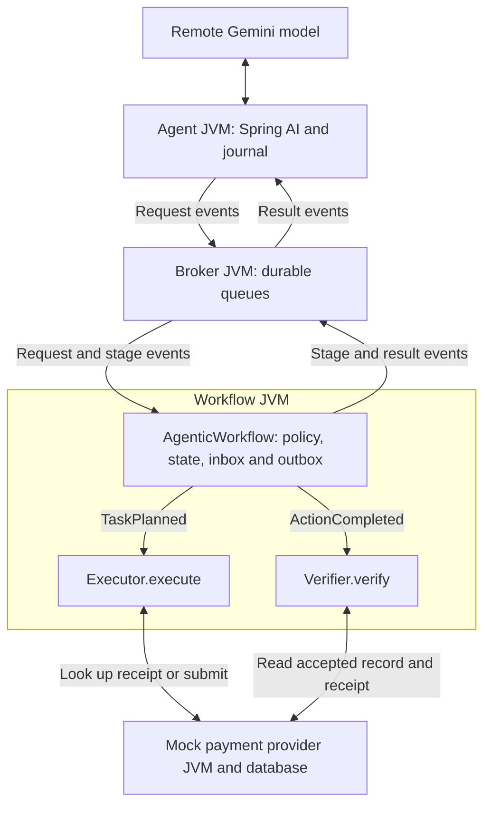

# When AI Agents Retry

Working Java demo for **When AI Agents Retry: Building Reliable Event-Driven Workflows**, DevFest Troy 2026.

The invoice-payment assistant uses **Spring AI 2.0.1 and Gemini** to select registered tools. A Java agent application dispatches those selections through durable events. Deterministic business code checks current policy, executes an approved payment request against a mock provider, and verifies the provider's persisted receipt.

**Current conference prerelease:** [v1.1.0-rc.1](https://github.com/kkmurthyt21/agent-retry-demo/releases/tag/v1.1.0-rc.1), containing the tested `1.1.0-candidate-build4-checkpoints` runtime. The [v1.0.0 release](https://github.com/kkmurthyt21/agent-retry-demo/releases/tag/v1.0.0) preserves the original offline example.

## What this demonstrates

An agent can receive `UNKNOWN` after a payment request has already been accepted and verified. It can query status or propose the same action again. A fresh model tool-call ID or event ID does not make that a new approved business operation.

The application owns the stable operation identity, trusted approval and payment parameters, workflow state, inbox/outbox and retry budgets. The mock payment provider owns its accepted payment records and receipts. The workflow retrieves that evidence, compares it with the saved approved request, and stores its result. These mechanisms protect the payment request across new agent requests and event redelivery.

| Scenario | Actual evidence |
| --- | --- |
| Live Gemini, normal execution | One payment proposal, one provider submission, one accepted mock payment record, VERIFIED |
| Live Gemini, completion consumer paused | Agent observed UNKNOWN; Gemini queried status; completion delivery count reached 2; one accepted record |
| Scripted repeated tool request | Programmed decisions proposed the same approved payment twice; the workflow reused its verified result; one provider submission and one accepted record |

The reported live recovery branch is **status reconciliation**, not a new Gemini payment proposal. `liveAgentRetryProven: false` is correct for that run. The scripted case separately forces a repeated tool call to test its protection. All three presenter-supplied Windows summaries report `invariantsPassed: true`.

**No real money moves.** The invoice and provider are test fixtures. VERIFIED means the provider record matches the approved request; settlement is outside the demo.

## Run the packaged demo

Download `agent-retry-demo-v1.1.0-rc.1.zip` from the [prerelease](https://github.com/kkmurthyt21/agent-retry-demo/releases/tag/v1.1.0-rc.1), extract it, and open PowerShell in the extracted folder containing `agent-retry-demo.jar`.

The JAR includes its runtime dependencies. Running it requires Java 17 or later; the presenter tested the live scenarios on Windows with Temurin 25.0.4.1. Maven, Docker and a cloud deployment are not needed to run the packaged JAR. Live mode requires a Gemini API key, access to the selected model and internet connectivity. The other Java processes run locally.

### Local check without a model service

```powershell
java -version
java "-Ddemo.debug=true" -jar .\agent-retry-demo.jar agentic --mode scripted --fault completion --wait-ms 8000
```

Expected: build4, `decisionSource: SCRIPTED`, two submit proposals, one provider submission, one accepted provider record, `verifiedReuse: 1`, and `invariantsPassed: true`.

### Live Gemini

Configure your existing Gemini key privately in `GEMINI_API_KEY`. If it is absent in this PowerShell session, the following prompts for masked entry:

```powershell
if ([string]::IsNullOrWhiteSpace($env:GEMINI_API_KEY)) {
    $demoSecureKey = Read-Host "Gemini API key" -AsSecureString
    $env:GEMINI_API_KEY = ([System.Net.NetworkCredential]::new("", $demoSecureKey)).Password
}
$env:GEMINI_MODEL = "gemini-3.5-flash-lite"
```

`gemini-3.5-flash-lite` is the model used in the reported successful Windows build4 runs. Model access and service latency must be checked in your own environment. The application requires an explicit tested model ID; it does not silently change model or switch to scripted mode.

Run these commands individually:

```powershell
java -jar .\agent-retry-demo.jar agentic preflight --mode gemini --check-model
java "-Ddemo.debug=true" -jar .\agent-retry-demo.jar agentic --mode gemini --fault none --wait-ms 8000
java "-Ddemo.debug=true" -jar .\agent-retry-demo.jar agentic --mode gemini --fault completion --wait-ms 8000
```

Preflight must identify `integration=SPRING_AI_GOOGLE_GENAI_2.0.1` and finish with `[MODEL_CONNECTED]`. It checks model connectivity, not the whole workflow. Scenario runs print `[RUN_SUMMARY]` and an `[EVIDENCE]` directory. Each scenario uses a fresh directory under `runs/` by default; no reset is needed between these agentic commands. Preflight does not create a scenario run directory.

`--wait-ms 8000` is the tool-observation deadline. Model requests have a separate 45-second limit, progress output every five seconds, and an application-owned budget of three API attempts per pending turn. A model API retry, a fresh payment proposal and broker redelivery have separate counters.

Read the [fresh-start checklist](docs/REHEARSAL_CHECKLIST.md) and [seven-minute demo walkthrough](docs/DEMO_SCRIPT.md). Preserve a successful live trace for a clearly labelled fallback: real model calls showed variable latency and one recovered HTTP 503.

## Architecture and source



Four local JVMs run: agent/launcher, broker, workflow application and mock provider. Planner, Executor and Verifier are logical responsibilities; Executor and Verifier are deterministic Java classes in the same workflow JVM. The model integration uses Spring AI programmatically, without Spring Boot.

### What a tool request means

A tool is a function the Java application describes to Gemini with a name, description and argument schema. A tool request is the model's structured selection of that function. For example, a Gemini response can contain this function-call part:

```json
{"functionCall":{"name":"submit_payment","args":{"invoiceId":"INV-1042"}}}
```

`GeminiPlannerModel` reads the structured response. `AgenticPlanner` validates the registered tool name and allowed arguments, saves the call and its outgoing event, and publishes it through the broker. Gemini does not call the payment service directly. The application supplies the approved amount, beneficiary, approval version and stable operation identity.

| Selected function | Event published by the agent | Workflow response |
| --- | --- | --- |
| `get_invoice_context(invoiceId)` | `ContextRequested` | Return the fixture's invoice approval, hold, amount and beneficiary facts |
| `get_payment_status(invoiceId)` | `StatusRequested` | Return the saved workflow state |
| `submit_payment(invoiceId)` | `ActionProposed` | Check policy; save and schedule the approved request, or reuse an existing verified result |

For this fixture, the approved request is **USD 250.00 for invoice `INV-1042` to `demo-beneficiary-001`, approval version 1**. Its stable identity is `demo-tenant:INV-1042:approval-v1:submit-payment`. `demo-tenant` identifies the example organization using the application. The provider is the separate local mock payment service; no real payment processor is contacted.

### Who invokes Executor and Verifier

`AgenticWorkflow` consumes the workflow queue and dispatches events in `handle(...)`:

| Event consumed | Java code invoked | Result |
| --- | --- | --- |
| `TaskPlanned` | `Executor.execute(...)` | Look up the same operation at the provider; recover a matching receipt or submit the saved approved request. Save `EXECUTED` and enqueue `ActionCompleted`. |
| `ActionCompleted` | `Verifier.verify(...)` | Read the provider's accepted record and receipt; compare their identity and payment fingerprint with the saved approved request. On a match, the workflow saves `VERIFIED` and enqueues `WorkflowVerified`. |

Executor performs or recovers the payment submission. Verifier checks the provider's stored outcome. Neither class runs a model or listens to the broker independently; the workflow worker invokes each when its event arrives. A mismatch fails verification with `VERIFICATION_MISMATCH`.

Applications publish, claim and acknowledge durable events through the demo broker's HTTP interface. A publish response confirms that the broker stored the event; payment completion arrives later as a result event. Gemini and the mock provider also expose HTTP APIs. Local workflow transactions do not include the provider's database. See the [event and transaction walkthrough](docs/AGENTIC_ARCHITECTURE.md) for inbox/outbox details.

| Concern | Source |
| --- | --- |
| Launch processes, readiness, fault selection and summary checks | `AgenticDemo.java` |
| Durable model/tool loop, pending calls, correlation and agent outbox | `AgenticPlanner.java` |
| Spring AI request, registered tools and Gemini protocol continuity | `GeminiPlannerModel.java`, `src/main/resources/agentic/` |
| Broker queues, delivery leases and ACK/NACK | `AgenticBroker.java` |
| Policy checkpoints, workflow state, inbox/outbox and stage handlers | `AgenticWorkflow.java` |
| Provider execution/reconciliation and evidence comparison | `Executor.java`, `Verifier.java` |
| Mock provider's atomic operation identity and accepted record | `AgenticGateway.java`, `MockPaymentGateway.java` |
| Status-export replacement and bounded file-system retries | `CheckpointFiles.java` |

Java sources are under `src/main/java/dev/agentretry/demo/`. See [event flow and transaction boundaries](docs/AGENTIC_ARCHITECTURE.md), [Spring AI integration](docs/SPRING_AI_INTEGRATION.md), [tool-call walkthrough](docs/AGENT_DECISION_WALKTHROUGH.md), and [Q&A](docs/AGENTIC_QA.md).

## Build and validation

Use **JDK 17 and Maven 3.9.x** for the complete test suite. The legacy offline network-denial integration test uses the JDK 17 SecurityManager mechanism; its build requirement differs from running the packaged agentic demo on Java 25.

```sh
mvn clean verify
```

The result is `target/agent-retry-demo.jar`. Model protocol tests use local simulated responses and require no Gemini key. The recorded build4 verification passed **95 tests: 85 unit and 10 integration, zero failures/errors/skips**, on Linux OpenJDK 17.0.20 and Maven 3.9.11. Separate presenter-supplied Windows summaries validate the three scenarios above. This publication also repeats the scripted completion smoke check against the exact packaged JAR.

See [validation and provenance](docs/TEST_RESULTS.md), [public evidence](evidence/README.md), [build4 changes](docs/CHECKPOINT_CANDIDATE.md) and [release notes](RELEASE_NOTES.md). The runtime JAR SHA-256 is:

```text
5ac099ff4d457c3c1ec9a87e494bda97a9b37aee3c9d7f0c1baf05bc857b4773
```

## Scope of the guarantees

- Versioned JSON contracts, durable state, current-policy checks, persisted budgets and separate failure categories are implemented in a deliberately narrow local fixture.
- Provider idempotency and authoritative receipt lookup protect the demonstrated side effect. A local deduplication row cannot guarantee exactly-once effects in an arbitrary external system.
- A worker crash after provider commit is a separate supported fault (`--fault worker`). Automated process tests cover it; it is not one of the three reported Windows build4 runs.
- This example does not establish production broker operations, multi-worker scaling, hardware-loss recovery, real payment settlement or Saga compensation.

Public evidence includes run summaries and an excerpt explicitly attributed to the presenter's console output. Full live traces remain on the presenter's Windows machine. Private H2 journals, model credentials and run databases are not distributed.

## Earlier offline example

The original `demo normal`, `boundaries`, `crash` and `recover` commands remain in the code. Their original documentation and release are preserved at [v1.0.0](https://github.com/kkmurthyt21/agent-retry-demo/tree/v1.0.0). The current primary walkthrough uses `agentic` commands above.

## Related work and license

Krishna Kandi, [Prevent Silent Failures Between AI Agents with Versioned Event Contracts on AWS](https://builder.aws.com/content/3Ivtw3UhZxxl2vzO4z293iDjLlL/prevent-silent-failures-between-ai-agents-with-versioned-event-contracts-on-aws), AWS Builder Center. The separate [AWS contract-gate project](https://github.com/kkmurthyt21/agent-event-contract-gate-aws) explores related contract checks; this demo requires no AWS deployment.

Apache License 2.0. See [LICENSE](LICENSE), [third-party notices](THIRD_PARTY_NOTICES.md) and the bundled `licenses/` directory.
