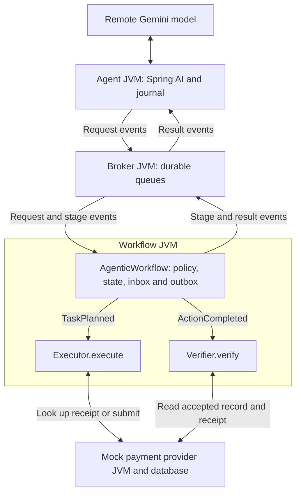

# Event-driven invoice-payment assistant

Spring AI 2.0.1 `GoogleGenAiChatModel` connects the Java agent application to Gemini. One model-powered planner selects registered tools. `Executor` and `Verifier` are deterministic Java classes inside `AgenticWorkflow`, the workflow-worker process. Four local Java processes own separate durable state. Gemini is remote in live mode; scripted mode is a labelled fixture.



Applications use the local broker's HTTP endpoints to publish (`/publish`), claim (`/claim`), acknowledge (`/ack`) or release (`/nack`) queued events. A publish response confirms storage of an event; it does not contain the payment outcome. The agent observes payment completion by consuming a separate result event. The mock provider exposes its own HTTP API for submission and evidence reads. The workflow progresses through durable events across separate processes.

## Business context and tool routing

The agent application creates a Spring AI Prompt with the user task, system prompt and registered ToolCallback schemas. GoogleGenAiChatModel sends the model request to Gemini. The application owns the tool execution loop. The model calls `get_invoice_context(invoiceId)`, `get_payment_status(invoiceId)` or `submit_payment(invoiceId)`. Java parses the structured function request, checks the registered name and allowed arguments, assigns an application tool-call ID and emits a domain event. It never executes arbitrary generated code. Tool results feed the same model conversation. Raw model content/signatures remain in the private journal for protocol continuity.

| Model request | Domain event | Deterministic handler |
| --- | --- | --- |
| get_invoice_context | ContextRequested | Reads approval/hold facts |
| get_payment_status | StatusRequested | Reads durable workflow state |
| submit_payment | ActionProposed | Checks policy and stores approved intent |

For example, this is the function-call part of a model response:

```json
{"functionCall":{"name":"submit_payment","args":{"invoiceId":"INV-1042"}}}
```

It requests a registered application function. Java translates it into an `ActionProposed` event; the model does not send an API request to the payment provider. `AgenticPlanner` saves the call and outgoing event before dispatch. Tool names and arguments are validated before any domain execution.

Trusted scope in this demo: `demo-tenant`, `INV-1042`, approval version 1. The operation key is `demo-tenant:INV-1042:approval-v1:submit-payment`. It identifies the approved USD 250.00 payment request to `demo-beneficiary-001`. Model call IDs correlate model responses, application tool-call IDs correlate tool results, and event IDs identify individual messages; none replaces this payment identity. Amount and beneficiary come from the fixed approved invoice fixture, never model-provided money fields. New approved requests would require new versioned identities and authorization; this deliberately narrow fixture does not implement an approval management product.

`demo-tenant` is the fixed identifier for the example organization using the application. The provider is the separate local `AgenticGateway` / `MockPaymentGateway` service, which owns its accepted payment records and receipts in its own database. The workflow owns the approved request, its workflow state and a saved copy of the receipt. This fixture does not implement a full multi-tenant service or contact a real bank.

## Executor and Verifier dispatch

`AgenticWorkflow.tick()` claims an event from the workflow queue and passes it to `handle(...)`. That method selects the stage by the event's `type`:

| Event consumed by the worker | Method called | Responsibility |
| --- | --- | --- |
| `TaskPlanned` | `new Executor(gateway).execute(tenant, operationId, approved, output)` | Call `gateway.find(tenant, operationId)` first. Return a matching receipt if it exists; otherwise call `gateway.submit(...)` with the saved approved request. |
| `ActionCompleted` | `new Verifier(gateway).verify(tenant, operationId, approved, localReceipt)` | Read `gateway.readInstruction(instructionId)` and `gateway.find(tenant, operationId)`, then compare the provider evidence with the saved approved request. |

The verifier checks that both provider reads exist, the payment record has the expected tenant and action key, the receipt refers to the same instruction ID, the provider status is `ACCEPTED`, and both the stored request and receipt fingerprint match the approved request. A mismatch throws `VERIFICATION_MISMATCH`. A normal return allows `AgenticWorkflow` to save `VERIFIED`; the verifier itself does not update the workflow state.

Executor and Verifier have no independent consumer loop. The workflow invokes them in response to their respective events. The separation makes submission and evidence checking explicit and allows verification to continue from the saved receipt without a new submission. It is a design choice within one worker JVM, not a requirement for three agent services.

## Durable event stages

| Transition | Event / precondition | State after local commit |
| --- | --- | --- |
| Proposal and authorization | ActionProposed, intentVersion 1, request version 0 | PLANNED, state version 1; TaskPlanned in outbox |
| External execution | TaskPlanned expects version 1 | EXECUTING, version 2; saved attempt count before effect |
| Provider receipt saved | Same execution event resumes after crash | EXECUTED, version 3; ActionCompleted in outbox |
| Provider-evidence verification | ActionCompleted expects version 3 | VERIFIED, version 4; WorkflowVerified for each waiting caller in outbox |

When a stage completes, a local transaction commits its workflow state, consumed-event inbox record and resulting outbox messages together. The pre-submission `EXECUTING` checkpoint and saved attempt count occur before contacting the provider; they do not mark `TaskPlanned` as completed. No workflow transaction includes the provider database. Provider idempotency and receipt lookup bridge that external commit gap. Provider verification reads the accepted payment record and provider-owned receipt. `ACCEPTED` records the approved request. Settlement is outside this demo.

### Inbox and transactional outbox

These are application database tables, separate from the broker's queues:

| Table | Purpose in this implementation |
| --- | --- |
| Inbox | Store a completed event's ID and payload fingerprint. Redelivery of that event is skipped; a different payload with the same ID is rejected. |
| Outbox | Store outgoing events in the same local transaction as the workflow change. `AgenticWorkflow.flush()` publishes ready rows to the broker and marks them sent. |

After Executor returns a receipt, one local transaction saves `EXECUTED` and the receipt, records the consumed `TaskPlanned` event in the inbox, and saves `ActionCompleted` in the outbox. The worker then acknowledges the consumed event and publishes the outgoing event. A crash before publication leaves the outbox row ready for recovery. A crash after publication but before marking the row sent can cause another publication of the same event ID; broker identity checks and the consumer inbox handle that duplicate. This local transaction pattern does not make the separate provider write atomic with the workflow database.

The single worker serializes this fixture. It does not claim multi-worker scaling or a production broker implementation. Lease fencing and inbox/outbox records make crash/redelivery behavior visible in a small local demo. Publication conflicts stop rather than silently accepting different payloads for an event ID.

## Primary failure: completion consumer pause

The provider has one accepted payment record. Workflow is VERIFIED and publishes completion. The agent's completion consumer claims that event, then pauses before recording its result or acknowledging the broker delivery. Its bounded tool wait yields UNKNOWN. Gemini can query status or request the same approved payment again. A fresh submit call has a new tool-call ID and event ID, but retains the same operation key. The workflow returns its saved verified result. The old completion redelivers, while the inbox/correlation rules keep it from overwriting the UNKNOWN result previously supplied for the original call.

This distinguishes a model's new proposal from infrastructure redelivery. Both can happen in one run; their identities and counters remain separate.

## Secondary failure: workflow worker crash

Only the worker halts after provider commit, before saving its local receipt. Broker and provider remain alive. On restart, the leased TaskPlanned redelivers. The same saved operation and immutable approved intent reach the executor. It recovers the provider receipt before attempting any new submission. Verification continues from provider evidence. The broker delivery and saved execution-attempt budgets survive the worker restart.

## Failure channels and limits

Unsupported contracts and stale events enter VALIDATION; authorization failures enter POLICY; exhausted transient work and evidence mismatch enter PROCESSING; failed outbox publication or broker lease exhaustion enter DELIVERY. Schema 1.0 and additive 1.1 are supported; unknown versions do not execute. Terminal domain failures notify waiting tool callers when the event is routable. Delivery failures remain durable for investigation; the candidate has no production operations console.

No global transaction, universal exactly-once effect guarantee, Saga compensation or real money settlement is implemented. Effect protection depends on the mock provider's atomic key-plus-mutation transaction. Real integrations need equivalent provider idempotency, reconciliation, retention rules, access controls and operational handling of unresolved outcomes.

## Spring AI boundary

The registered callbacks supply schemas. They cannot execute a payment directly. AgenticPlanner saves and dispatches selected tools through its outbox. GeminiPlannerModel uses Spring AI for the model call while retaining original provider content parts in the private journal. This preserves signatures and provider call IDs across restart. Read SPRING_AI_INTEGRATION.md for the exact adapter and test boundaries.
