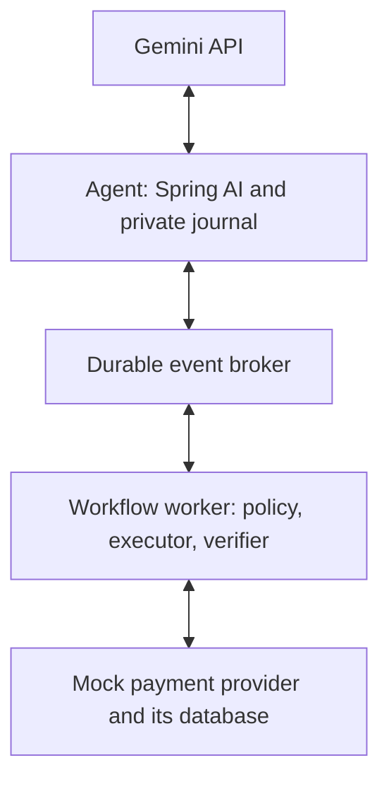

# Event-driven invoice-payment assistant

Spring AI 2.0.1 GoogleGenAiChatModel connects the Java agent application to Gemini. One model-powered planner selects registered tools. Executor and verifier are deterministic business responsibilities in the domain worker. Four local Java processes own separate durable state. Gemini is remote in live mode; scripted mode is a labelled fixture.

HTTP transports broker publish/claim/ACK and mock-provider calls. Business requests and completion travel through durable queues. The architecture does not depend on holding an HTTP response open from executor to agent.

## Business context and tool routing

The agent application creates a Spring AI Prompt with the user task, system prompt and registered ToolCallback schemas. GoogleGenAiChatModel sends the model request to Gemini. The application owns the tool execution loop. The model calls `get_invoice_context(invoiceId)`, `get_payment_status(invoiceId)` or `submit_payment(invoiceId)`. Java parses the structured function request, checks the registered name and allowed arguments, assigns an application tool-call ID and emits a domain event. It never executes arbitrary generated code. Tool results feed the same model conversation. Raw model content/signatures remain in the private journal for protocol continuity.

| Model request | Domain event | Deterministic handler |
| --- | --- | --- |
| get_invoice_context | ContextRequested | Reads approval/hold facts |
| get_payment_status | StatusRequested | Reads durable workflow state |
| submit_payment | ActionProposed | Checks policy and stores approved intent |

Trusted scope in this demo: `demo-tenant`, `INV-1042`, approval version 1. The operation key is `demo-tenant:INV-1042:approval-v1:submit-payment`. It belongs to an approved business action; it is not the model call ID or event ID. Amount USD 250.00 and beneficiary come from deterministic invoice policy, never model-provided money fields. New approved intents would require new versioned identities and authorization; this deliberately narrow fixture does not implement an approval management product.

## Durable event stages

| Transition | Event / precondition | State after local commit |
| --- | --- | --- |
| Proposal and authorization | ActionProposed, intentVersion 1, request version 0 | PLANNED, state version 1; TaskPlanned in outbox |
| External execution | TaskPlanned expects version 1 | EXECUTING, version 2; saved attempt count before effect |
| Provider receipt saved | Same execution event resumes after crash | EXECUTED, version 3; ActionCompleted in outbox |
| Independent verification | ActionCompleted expects version 3 | VERIFIED, version 4; WorkflowVerified for each waiting caller in outbox |

A workflow transaction commits its state, event inbox record and resulting outbox messages together. It never includes the provider database. Provider idempotency and receipt lookup bridge the external commit gap. Provider verification reads the accepted payment record and provider-owned receipt. ACCEPTED records the approved request. Settlement is outside this demo.

The single worker serializes this fixture. It does not claim multi-worker scaling or a production broker implementation. Lease fencing and inbox/outbox records make crash/redelivery behavior visible in a small local demo. Publication conflicts stop rather than silently accepting different payloads for an event ID.

## Primary failure: completion consumer pause

The provider has one accepted payment record. Workflow is VERIFIED and publishes completion. The agent's completion consumer claims that event, then pauses before recording its result or acknowledging the broker delivery. Its bounded tool wait yields UNKNOWN. Gemini can query status or request the same approved payment again. A fresh submit call has a new tool-call ID and event ID, but retains the same operation key. The workflow returns its saved verified result. The old completion redelivers, while the inbox/correlation rules keep it from overwriting the UNKNOWN result previously supplied for the original call.

This distinguishes a model's new proposal from infrastructure redelivery. Both can happen in one run; their identities and counters remain separate.

## Secondary failure: workflow worker crash

Only the worker halts after provider commit, before saving its local receipt. Broker and provider remain alive. On restart, the leased TaskPlanned redelivers. The same saved operation and immutable approved intent reach the executor. It recovers the provider receipt before attempting any new submission. Verification continues from provider evidence. The broker delivery and saved execution-attempt budgets survive the worker restart.

## Failure channels and limits

Unsupported contracts and stale events enter VALIDATION; authorization failures enter POLICY; exhausted transient work and evidence mismatch enter PROCESSING; failed outbox publication or broker lease exhaustion enter DELIVERY. Schema 1.0 and additive 1.1 are supported; unknown versions do not execute. Terminal domain failures notify waiting tool callers when the event is routable. Delivery failures remain durable for investigation; the candidate has no production operations console.

No global transaction, universal exactly-once effect guarantee, Saga compensation or real money settlement is implemented. Effect protection depends on the mock provider's atomic key-plus-mutation transaction. Real integrations need equivalent provider idempotency, reconciliation, retention rules, access controls and operational handling of unresolved outcomes.

## Spring AI boundary

The registered callbacks supply schemas. They cannot execute a payment directly. AgenticPlanner saves and dispatches selected tools through its outbox. GeminiPlannerModel uses Spring AI for the model call while retaining original provider content parts in the private journal. This preserves signatures and provider call IDs across restart. Read SPRING_AI_INTEGRATION.md for the exact adapter and test boundaries.
