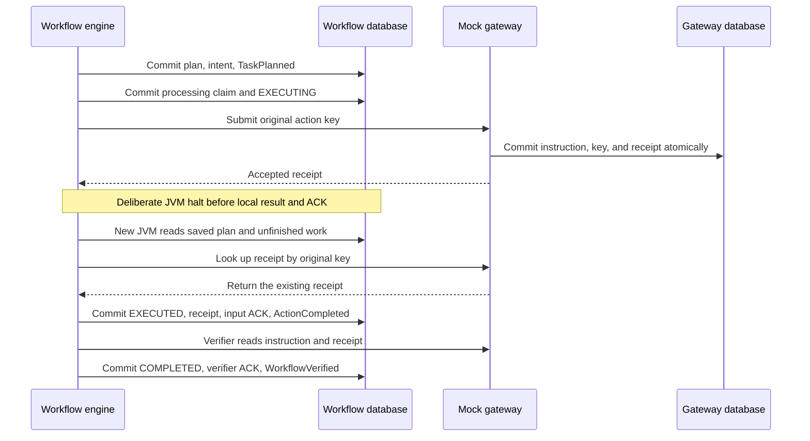

# Architecture

The unit of work is one authorized synthetic payment-instruction submission. Success means the mock gateway accepted one instruction and the Verifier checked its persisted parameters. The fixture is independent of any financial-network protocol or real customer data.

## Responsibilities

| Responsibility | Owner | Durable evidence |
|---|---|---|
| Proposed instruction | Deterministic Planner | Saved proposal and approved request |
| Permission | Application policy | Trusted subject, policy version, allow/deny record |
| Submission | Executor | Original tenant/action key and provider receipt |
| Acceptance | Mock payment gateway | Instruction and operation records in its own database |
| Verification | Verifier | Comparison with the provider-owned instruction |
| Recovery | Workflow engine | State/version, queue, processing identity, and budgets |

The prompt is replaceable reasoning context. The workflow database owns decisions that must survive a process exit. The example persists the plan before execution and never runs the completed Planner again during recovery.

## The commit/acknowledgement gap

The gateway stays behind a Java interface and uses its own H2 connection and transaction. There is no transaction spanning both databases. Both anchors remain open at the deliberate halt. `WRITE_DELAY=0` is configured before application transactions.

| Boundary | Atomic commit | Recovery interpretation |
|---|---|---|
| A0: plan | Plan, action fingerprint, `PLANNED` version 1, queued `TaskPlanned` | The intended work exists even before dispatch |
| A1: processing claim | In-progress event identity, attempt, `EXECUTING` version 2 | Claimed work has not established success |
| B: provider | Accepted instruction, unique scoped action key, fingerprint, replayable receipt | The business effect may exist while local state remains unfinished |
| C: local completion | Receipt, action `EXECUTED`, workflow version 3, Executor input ACK, `ActionCompleted` | Recovery proceeds to verification |
| D: verification | Workflow `COMPLETED` version 4, Verifier ACK, `WorkflowVerified` | Workflow is complete |

Delivery handoff has its own committed attempt before handler invocation. Delivery and processing counters are separate and cumulative. The terminal fact is acknowledged by a small local audit consumer.

## Identity and canonical parameters

`consumer + source + eventId` identifies one delivered fact. Its canonical whole-event fingerprint detects conflicting reuse of that identity. Canonicalization sorts object keys, preserves array order, and normalizes equivalent numeric representations.

The business key is `demo-tenant:<workflowId>:submit-payment-instruction`. It identifies one immutable business step. It never includes an attempt number.

The action fingerprint covers `action`, debit account, beneficiary, integer minor-unit amount, currency, route, and the optional client reference. An absent client reference has the explicit default empty string. Schema checks reject invalid types before processing. There is no case folding or account-reference rewriting. The gateway compares fingerprints before returning a cached result.

## Policy and state checkpoints

The trusted row fixes tenant `demo-tenant`, subject `demo-operator`, and role `PAYMENT_SUBMITTER`. The event cannot assert its own privileges. The demo permits the synthetic debit account, beneficiary `demo-beneficiary-001`, currency `USD`, route `DEMO_NETWORK`, and amounts up to `100000` minor units. The normal amount is `25000`.

Policy checks occur during plan approval and again before an operation that might submit to the gateway. Parameters must match the approved request. Ordinary new execution expects state version 1. Resuming a saved `IN_PROGRESS` action permits the original expected version 1 while the workflow is `EXECUTING` at version 2, after checking the saved key and immutable fingerprint. This exception cannot authorize changed intent.

An existing completed outcome can be returned to a matching duplicate without authorizing another mutation. Recovery of an unfinished action still passes current policy. A policy change or expired deadline can lead to review even when the provider may already have an acceptance; neither decision undoes that acceptance.

## Failure channels and retry decisions

| Category | Meaning | Application decision |
|---|---|---|
| `VALIDATION` | Unsupported, malformed, or incompatible event | Reject before execution |
| `POLICY` | Unauthorized request or stale transition | Reject or preserve for review |
| `DELIVERY` | Handoff fails before invocation | Retry within the saved delivery budget |
| `PROCESSING` | Invoked stage fails | Retry only transient failures within its saved processing budget |

There are three total attempts in each budget, including the first. Delivery attempts count every handoff, including handoffs on processing retries. Processing attempts count actual handler starts. Both budgets constrain a stage; neither replenishes the other. Backoff is 1 second then 2 seconds. `next_at` and the 15-minute workflow deadline persist. New envelopes share the stage budget. Tests control the clock instead of sleeping.

The workflow and queue use separate status fields. An interrupted in-flight delivery can be reclaimed only after the next process owns the OS lock. A clean retry waiting in the future retains its schedule after restart. Budget exhaustion records `NEEDS_REVIEW` and preserves the intent and any receipt.

## Limits of the demonstration

One workflow dispatcher owns the fixture directory. The provider’s unique-key transaction is also tested with concurrent JDBC connections in the same JVM. A production multiworker design needs claim ownership, fencing or comparable coordination, and correct state transitions.

No key expiry runs in this example. A real provider’s retention period must cover permitted retries and replay. Without provider idempotency or dependable reconciliation, an ambiguous action needs a review path. An outbox or local processed-event row cannot independently establish exactly-once effects in an external system.

References: [Transactional Outbox](https://microservices.io/patterns/data/transactional-outbox.html), [Idempotent Consumer](https://microservices.io/patterns/communication-style/idempotent-consumer.html), [Making retries safe with idempotent APIs](https://aws.amazon.com/builders-library/making-retries-safe-with-idempotent-APIs/), [H2 WRITE_DELAY](https://h2database.com/html/commands.html#set_write_delay), and [JSON Schema object behavior](https://json-schema.org/understanding-json-schema/reference/object).
